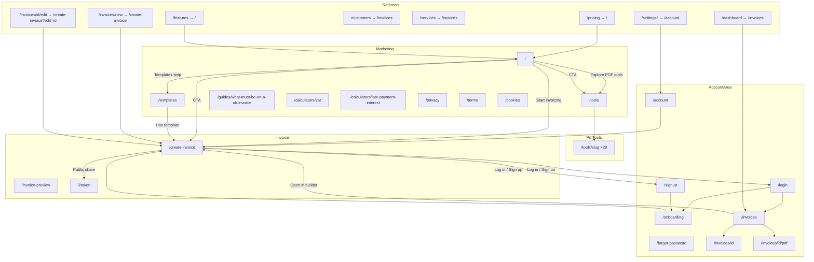

# SterlingSend site map

Generated from the App Router tree, `next.config.ts` redirects/rewrites, production build output (`.next/server/app`), and a Playwright crawl against `http://127.0.0.1:3103` (`npm run build` + `npm run start`). Crawl artefact: `.perf/site-crawl.json` (2026-10-23).

**Excluded:** `/dev/*` (styleguide, invoice-fixture, template-thumb).

**Auth crawl limit:** Cookie `__session=crawl-hint-session` + `localStorage ss_auth=1` does **not** produce a valid Firebase session. Protected routes still land on `/login` after server/client session checks. Logged-in page *content* below is from code, not a live authenticated render.

---

## Route inventory (cross-check)

| Source | Routes (excl. `/dev`) |
| --- | --- |
| `app/**/page.tsx` | `/`, `/create-invoice`, `/templates`, `/tools`, `/tools/[slug]`, `/guides/what-must-be-on-a-uk-invoice`, `/calculators/vat`, `/calculators/late-payment-interest`, `/privacy`, `/terms`, `/cookies`, `/login`, `/signup`, `/forgot-password`, `/invoice-preview`, `/i/[publicToken]`, `/pay/[invoiceId]`, `/account`, `/invoices`, `/invoices/[id]`, `/invoices/[id]/pdf`, `/invoices/new`, `/invoices/[id]/edit`, `/settings`, `/settings/[...slug]`, `/onboarding` |
| `app/**/not-found.tsx` | Root `app/not-found.tsx`; `app/(public)/i/[publicToken]/not-found.tsx` |
| `app/api/**/route.ts` | `/api/auth/session`, `/api/webhooks/stripe`, `/api/payments/checkout` |
| `next.config` redirects | `/dashboard`, `/customers`, `/services` → `/invoices`; `/pricing`, `/features` → `/` (308) |
| `next.config` rewrites | `/__/auth/:path*` → Firebase auth host |
| Build `.next/server/app` | Same page set as app dir (groups: auth, dashboard, onboarding, payment, public) + `_not-found` |
| Dynamic catalogs | PDF tools: 29 slugs in `features/pdf-tools/catalog.ts`. Templates: 18 layout ids in `pdf/templates/catalog.ts` (`classic`…`noir`). Public invoice token and invoice ids are Firestore-backed (no static slug list). |

### PDF tool slugs (29)

`compress-pdf`, `repair-pdf`, `ocr-pdf`, `pdf-to-word`, `pdf-to-powerpoint`, `pdf-to-excel`, `pdf-to-jpg`, `jpg-to-pdf`, `word-to-pdf`, `html-to-pdf`, `pdf-to-pdfa`, `pdf-to-markdown`, `merge-pdf`, `split-pdf`, `remove-pages`, `extract-pages`, `organize-pdf`, `edit-pdf`, `rotate-pdf`, `crop-pdf`, `page-numbers`, `watermark`, `pdf-forms`, `unlock-pdf`, `protect-pdf`, `sign-pdf`, `redact-pdf`, `compare-pdf`, `translate-pdf`

### Template layout ids (18)

`classic`, `ledger`, `editorial`, `receipt`, `statement`, `split`, `corporate`, `compact`, `ribbon`, `fold`, `stack`, `pillar`, `clay`, `cube`, `tab`, `emboss`, `seal`, `noir`

---

## Diagram

Source file: [`docs/site-map.mmd`](./site-map.mmd).

---

## Navigation matrix

| Page | Desktop nav (guest) | Desktop nav (logged in) | Mobile menu | PDF tools dropdown | Footer | Site search | Home page |
| --- | --- | --- | --- | --- | --- | --- | --- |
| `/` | Logo only | Logo only | Logo | — | Logo | Yes | — |
| `/create-invoice` | Yes | Yes | Yes | — | Yes (Product) | Yes | Hero + CTA |
| `/templates` | Yes | Yes | Yes | — | Yes | Yes | Templates strip |
| `/tools` | Via PDF menu | Via PDF menu | Yes | “See all tools” | Yes | Yes | Popular + CTA |
| `/tools/[slug]` ×29 | Subset in mega (≤6/cat) | Same | Subset | Yes (per category slice) | First 8 ready tools | Yes (all 29) | 8 popular |
| `/invoices` (History) | No | Yes | If logged in / hint | — | No | No | No |
| `/account` | No | Avatar menu | If logged in | — | No | No | No |
| `/login` | Yes (right) | Hidden when user | Yes when guest | — | No | No | Guest line |
| `/signup` | Yes (right) | Hidden when user | Yes when guest | — | No | No | No |
| `/forgot-password` | No | No | No | — | No | No | No |
| `/onboarding` | No | No | No | — | No | No | No |
| Guide + calculators | No | No | No | — | No | **Missing** | No |
| Legal (privacy/terms/cookies) | No | No | No | — | Yes | Yes | Files section → privacy |
| `/i/[token]` | No | No | No | — | No | No | No |
| `/invoice-preview` | No | No | No | — | No | No | No |
| `/pay/[id]` | No | No | No | — | No | No | No |

**Flags (missing where useful):**

- Guides and calculators: not in nav, footer, or site search → **orphan inbound links** in crawl.
- `/forgot-password`: only linked from login form (OK).
- History / Account: correctly gated to logged-in UI only.

---

## Redirect table

Tested with `curl -I` / `curl -L` against `http://127.0.0.1:3103` (production `next start`).

| Source | First response | Target | Follow final (guest) | Notes |
| --- | --- | --- | --- | --- |
| `/pricing` | **308** | `/` | 200 `/` | `next.config` permanent |
| `/features` | **308** | `/` | 200 `/` | `next.config` permanent |
| `/dashboard` | **308** | `/invoices` | 200 `/login?redirect=%2Finvoices` | Then middleware |
| `/services` | **308** | `/invoices` | 200 `/login?redirect=%2Finvoices` | Then middleware |
| `/customers` | **308** | `/invoices` | 200 `/login?redirect=%2Finvoices` | Then middleware |
| `/settings` | **307** | `/login?redirect=%2Fsettings` | 200 login | Middleware first (no session). Code: `permanentRedirect(/account)` after auth |
| `/settings/business` | **307** | login + redirect | 200 login | Same; slug page → `/account` when reached |
| `/settings/invoices` | **307** | login + redirect | 200 login | Same |
| `/invoices/new` | **307** | login + redirect | 200 login | Code: `permanentRedirect(/create-invoice)` when reached |
| `/invoices/abc/edit` | **307** | login + redirect | 200 login | Code: `permanentRedirect(/create-invoice?edit=abc)` when reached |
| `/invoices` (guest) | **307** | `/login?redirect=%2Finvoices` | 200 login | Middleware |
| `/account` (guest) | **307** | `/login?redirect=%2Faccount` | 200 login | Middleware |

**Could not verify:** HTTP status of `permanentRedirect` for `/settings` → `/account` and `/invoices/new` → `/create-invoice` with a **valid** Firebase `__session` (fake cookie triggered `clearSession` / login). Targets confirmed in page source.

---

# Marketing

## `/` — Home

- **File:** `app/(public)/page.tsx` (+ `features/marketing`)
- **Title:** Free invoice maker and PDF tools | SterlingSend
- **Meta description:** Create invoices and use every PDF tool free, no login needed. Sign up only to keep your invoice history. (104 chars — outside 140–160)
- **Canonical:** `https://sterlingsend.com`
- **Purpose:** Landing for free invoicing + PDF tools.
- **Access:** Both (guest and logged in).
- **Sections (rendered):** Brand/chip → H1 → CTAs → hero invoice sheet → Popular PDF tools → Invoice templates → How your files are handled → Questions (FAQ) → Join freelancers… CTA → footer (Product / Popular tools / Legal).
- **Main actions:** Start invoicing → `/create-invoice`; Explore PDF tools → `/tools`; template cards → `/templates`; CTA Create / Open PDF tools; Log in link (guest line).
- **Links in:** Footer/logo, 404, redirects from pricing/features, most marketing pages.
- **Links out:** `/create-invoice`, `/tools`, `/templates`, `/login`, `/signup`, `/privacy`, `/cookies`, `/terms`, popular tool URLs.
- **Data:** None server-side. Cookie banner may write `ss_consent`.
- **States:** Static; FAQ/client bits only.
- **Indexing:** In sitemap.xml; indexable.
- **Status:** Done.
- **Tests:** `scripts/test-sitemap.mjs`; crawl; design-review / visual scripts hit home.

## `/templates`

- **File:** `app/(public)/templates/page.tsx`
- **Title:** Invoice templates | SterlingSend
- **Description:** Browse 18 invoice templates… (112 chars)
- **Canonical:** `https://sterlingsend.com/templates`
- **Purpose:** Gallery of 18 layouts; pick colour/layout then create.
- **Access:** Both.
- **Sections:** Eyebrow Gallery → H1 Invoice templates → per-template H2s (Classic…Noir) → footer.
- **Actions:** Use / pick template → `/create-invoice` (sets template preference).
- **Links in:** Nav, footer, home strip.
- **Links out:** `/create-invoice`, shell links.
- **Data:** Reads template catalog (static). May write session template preference (`ss_template` / accent).
- **States:** Interactive gallery dialogs.
- **Indexing:** Sitemap yes.
- **Status:** Done.
- **Tests:** sitemap test; crawl; `design-review-18-theme.mjs`, template thumbs scripts.

## `/tools`

- **File:** `app/(public)/tools/page.tsx`
- **Title:** PDF tools | SterlingSend
- **Description:** 29 PDF tools… (105 chars)
- **Canonical:** `https://sterlingsend.com/tools`
- **Purpose:** Hub + search/filter for all PDF tools.
- **Access:** Both.
- **Sections:** H1 PDF tools → Popular → category H2s (Optimize, Convert, Organize, Edit, Security) → link to create invoice → footer.
- **Actions:** Search/filter; open tool → `/tools/[slug]`; Create invoice link.
- **Links in:** Nav mega, footer, home, tool related links.
- **Links out:** All 29 tool URLs, `/create-invoice`, legal.
- **Data:** Client catalog filter only; tools process files in-browser (or confirm for translate/OCR).
- **Indexing:** Sitemap yes.
- **Status:** Done.
- **Tests:** sitemap; crawl; `tool-regression-p4.mjs`.

---

# Invoice

## `/create-invoice` — Builder

- **File:** `app/(public)/create-invoice/page.tsx`
- **Title:** Create an invoice | SterlingSend
- **Description:** Build a UK invoice… (136 chars)
- **Canonical:** `https://sterlingsend.com/create-invoice`
- **Purpose:** Guest/logged-in invoice builder with live preview and PDF download.
- **Access:** Both. `?edit=` loads Firestore invoice when logged in (else `notFound`).
- **Sections:** H1 Create an invoice; preview H1 INVOICE; Notes / Payment details / Terms; toolbar actions.
- **Actions:** Edit fields; template/colour; Download PDF; Print; Save (logged in); Log in / Sign up.
- **Links in:** Home, templates, nav, footer, redirects from `/invoices/new` and `/invoices/[id]/edit`.
- **Links out:** `/templates`, `/login`, `/signup`, `/`.
- **Data R/W:** localStorage `ss_guest_invoice`, `ss_guest_invoice_draft`, `ss_guest_onboarding_seed`; sessionStorage `ss_accent`, `ss_guest_pdf_rate`; logged-in → Firestore `invoices`, `settings`, `businesses`.
- **States:** Loading edit; save idle/saving/saved/error; download confirm; empty line items.
- **Indexing:** Sitemap yes. **Issue:** two H1s (`Create an invoice` + preview `INVOICE`).
- **Status:** Done.
- **Tests:** crawl; PDF quality / compare-guest / e2e stamp scripts.

## `/invoice-preview`

- **File:** `app/(public)/invoice-preview/page.tsx`
- **Title/desc:** Falls back to root defaults; canonical points to `/create-invoice`.
- **Purpose:** Guest preview shell (`GuestInvoicePreview`).
- **Access:** Both (guest-oriented).
- **Sections:** Same builder-like headings (Create an invoice / INVOICE) in crawl.
- **Actions:** Preview-related; links to builder/auth.
- **Links in:** None found in crawl (orphan).
- **Data:** Guest invoice storage keys.
- **Indexing:** Not in sitemap; canonical to create-invoice.
- **Status:** Partial / legacy path.
- **Tests:** crawl only.

## `/i/[publicToken]` — Public invoice

- **File:** `app/(public)/i/[publicToken]/page.tsx`
- **Title:** Invoice; `robots: noindex,nofollow`
- **Purpose:** Customer-facing shared invoice + payment state.
- **Access:** Both (token required). Invalid token → not-found (404).
- **Sections:** From `PublicInvoicePage` (loading skeleton; pay CTA when applicable).
- **Actions:** View; pay → `/pay/[invoiceId]` / Stripe checkout API.
- **Data:** Firestore invoices/payments via `invoicePaymentService`; records public view.
- **Indexing:** Excluded from sitemap; robots Disallow `/i/`.
- **Status:** Done (needs real token to render 200).
- **Tests:** Crawl with `example-public-token` → **404** (expected).

---

# PDF tools

## Hub

See Marketing `/tools`.

## Every tool page (`/tools/[slug]`)

- **File:** `app/(public)/tools/[slug]/page.tsx` (`generateStaticParams` from catalog)
- **Shared purpose:** Run one PDF operation (upload → process → download).
- **Access:** Both (no login).
- **Shared sections (rendered):** H1 (tool title) → How it works → Questions → Related tools → footer.
- **Actions:** File upload / options form → process → download; related tool links; back to `/tools`.
- **Data:** In-browser processing for most tools; translate/OCR may call network after confirm; no Firestore.
- **States:** Empty (no file), processing, error, success/download.
- **Indexing:** All 29 in sitemap.xml.
- **Status:** Done (`status: ready` in catalog).
- **Tests:** sitemap (each URL 200); crawl; `tool-regression-p4.mjs`.

| Slug | Title | Desc len | H1 | Canonical | Sitemap |
| --- | --- | ---: | --- | --- | --- |
| compress-pdf | Compress PDF | 116 | Compress PDF | yes | yes |
| repair-pdf | Repair PDF | 117 | Repair PDF | yes | yes |
| ocr-pdf | OCR PDF | 160 | OCR PDF | yes | yes |
| pdf-to-word | PDF to Word | 116 | PDF to Word | yes | yes |
| pdf-to-powerpoint | PDF to PowerPoint | 114 | PDF to PowerPoint | yes | yes |
| pdf-to-excel | PDF to Excel | 114 | PDF to Excel | yes | yes |
| pdf-to-jpg | PDF to JPG | 119 | PDF to JPG | yes | yes |
| jpg-to-pdf | JPG to PDF | 122 | JPG to PDF | yes | yes |
| word-to-pdf | Word to PDF | 121 | Word to PDF | yes | yes |
| html-to-pdf | HTML to PDF | 131 | HTML to PDF | yes | yes |
| pdf-to-pdfa | PDF to PDF/A | 114 | PDF to PDF/A | yes | yes |
| pdf-to-markdown | PDF to Markdown | 127 | PDF to Markdown | yes | yes |
| merge-pdf | Merge PDF | 129 | Merge PDF | yes | yes |
| split-pdf | Split PDF | 112 | Split PDF | yes | yes |
| remove-pages | Remove pages | 106 | Remove pages | yes | yes |
| extract-pages | Extract pages | 109 | Extract pages | yes | yes |
| organize-pdf | Organize PDF | 112 | Organize PDF | yes | yes |
| edit-pdf | Edit PDF | 128 | Edit PDF | yes | yes |
| rotate-pdf | Rotate PDF | 112 | Rotate PDF | yes | yes |
| crop-pdf | Crop PDF | 99 | Crop PDF | yes | yes |
| page-numbers | Page numbers | 103 | Page numbers | yes | yes |
| watermark | Watermark | 99 | Watermark | yes | yes |
| pdf-forms | PDF Forms | 118 | PDF Forms | yes | yes |
| unlock-pdf | Unlock PDF | 124 | Unlock PDF | yes | yes |
| protect-pdf | Protect PDF | 100 | Protect PDF | yes | yes |
| sign-pdf | Sign PDF | 121 | Sign PDF | yes | yes |
| redact-pdf | Redact PDF | 124 | Redact PDF | yes | yes |
| compare-pdf | Compare PDF | 111 | Compare PDF | yes | yes |
| translate-pdf | Translate PDF | 143 | Translate PDF | yes | yes |

Almost all descriptions are outside 140–160 (crawl SEO). Titles unique and &lt; 60 chars (sans brand suffix).

---

# Account

## `/login`

- **File:** `app/(auth)/login/page.tsx`
- **Title:** SterlingSend (root default); **no canonical**
- **Description:** Root default (104 chars)
- **Purpose:** Email/password + Google sign-in.
- **Access:** Guest. Logged-in users may be redirected by auth actions.
- **Sections:** H1 Welcome back to SterlingSend; form; links to signup / forgot-password.
- **Actions:** Submit → session cookie + redirect (`/onboarding` or `redirect` query / history).
- **Data:** Firebase Auth; `POST /api/auth/session`; cookie `__session`.
- **States:** Loading Suspense; form errors; success toast.
- **Indexing:** robots Disallow `/login`; not in sitemap.
- **Status:** Done.
- **Tests:** crawl (200).

## `/signup`

- **File:** `app/(auth)/signup/page.tsx`
- **Title/desc:** Root defaults; **no canonical**; **h1Count=2** in crawl
- **Purpose:** Create account.
- **Access:** Guest.
- **Sections:** Save your work / marketing H1; signup form.
- **Actions:** Sign up → onboarding; link to login.
- **Indexing:** Disallow; not in sitemap.
- **Status:** Done.

## `/forgot-password`

- **File:** `app/(auth)/forgot-password/page.tsx`
- **Title/desc:** Root defaults; **no canonical**; **h1Count=2**
- **Purpose:** Password reset email.
- **Access:** Guest.
- **Actions:** Submit email form.
- **Links in:** Login only.
- **Indexing:** Disallow; not in sitemap.
- **Status:** Done.

## `/onboarding`

- **File:** `app/(onboarding)/onboarding/page.tsx`
- **Purpose:** Business profile wizard after signup.
- **Access:** Logged in only (middleware + `getServerSession` → login).
- **Data:** localStorage `ss_onboarding_draft`, `ss_guest_onboarding_seed`; writes Firestore `businesses` / `users` / `settings`.
- **Indexing:** Disallow; not in sitemap.
- **Status:** Done (content not live-crawled with valid session).

## `/account`

- **File:** `app/(dashboard)/account/page.tsx`
- **Purpose:** Account / branding settings (replaces old settings hub).
- **Access:** Logged in + onboarding complete (`requireOnboarding`).
- **Data:** Reads/writes `businesses`, `settings` (template, accent, logo).
- **Indexing:** Disallow; not in sitemap.
- **Status:** Done (auth-gated).

## `/invoices` — History

- **File:** `app/(dashboard)/invoices/page.tsx`
- **Purpose:** Saved invoice list (History).
- **Access:** Logged in + onboarding.
- **Data:** Firestore `invoices` (paginate); empty / loadError states.
- **Actions:** Open detail, PDF, edit via builder.
- **Indexing:** Disallow `/invoices`; not in sitemap.
- **Status:** Done.

## `/invoices/[id]`

- **File:** `app/(dashboard)/invoices/[id]/page.tsx`
- **Purpose:** Invoice detail for owner.
- **Access:** Logged in.
- **Status:** Done (dynamic id).

## `/invoices/[id]/pdf`

- **File:** `app/(dashboard)/invoices/[id]/pdf/page.tsx`
- **Purpose:** PDF view route for a saved invoice.
- **Access:** Logged in.
- **Status:** Done.

## Redirect stubs

| URL | File | Intended target |
| --- | --- | --- |
| `/invoices/new` | `…/invoices/new/page.tsx` | `/create-invoice` |
| `/invoices/[id]/edit` | `…/edit/page.tsx` | `/create-invoice?edit=[id]` |
| `/settings` | `…/settings/page.tsx` | `/account` |
| `/settings/[...slug]` | `…/settings/[...slug]/page.tsx` | `/account` |

---

# Guides and calculators

## `/guides/what-must-be-on-a-uk-invoice`

- **Title:** What must be on a UK invoice | SterlingSend
- **Description:** Checklist… (105 chars)
- **Canonical:** yes
- **Purpose:** UK invoice checklist with GOV.UK links.
- **Access:** Both.
- **Sections:** H1 → Checklist → footer.
- **Links in:** **None** (orphan). Not in search index.
- **Indexing:** Sitemap yes.
- **Status:** Done; discoverability gap.

## `/calculators/vat`

- **Title:** UK VAT calculator | SterlingSend
- **Description:** 108 chars
- **Canonical:** yes
- **Purpose:** Add/remove UK VAT.
- **Access:** Both.
- **Sections:** H1 + calculator UI → footer.
- **Links in:** None (orphan). Not in search.
- **Indexing:** Sitemap yes.
- **Status:** Done; discoverability gap.

## `/calculators/late-payment-interest`

- **Title:** Late payment interest calculator | SterlingSend
- **Description:** 151 chars (in band)
- **Canonical:** yes
- **Purpose:** Late payment interest calc.
- **Access:** Both.
- **Links in:** None (orphan).
- **Indexing:** Sitemap yes.
- **Status:** Done; discoverability gap.

---

# Legal

## `/privacy` · `/terms` · `/cookies`

- **Files:** `app/(public)/privacy|terms|cookies/page.tsx`
- **Titles:** Privacy Policy / Terms of Service / Cookie Policy
- **Canonicals:** yes on sterlingsend.com
- **Desc lengths:** privacy 142 (OK); terms 126; cookies 105
- **Access:** Both
- **Sections:** Policy H2s (see crawl) + footer
- **Links in:** Footer; home files section → privacy; cookie banner → cookies
- **Indexing:** Sitemap yes
- **Status:** Done

---

# System

## 404 (`app/not-found.tsx`)

- Crawl probe `/this-page-does-not-exist-404-check` → **404**, H1 “Page not found”
- Actions: Create invoice, Browse PDF tools, Home
- Not in sitemap

## `/pay/[invoiceId]`

- **File:** `app/(payment)/pay/[invoiceId]/page.tsx`
- **Purpose:** Payment flow for an invoice
- **Access:** Both (invoice-scoped)
- Example id → **404** in crawl
- robots Disallow `/pay/`
- Not in sitemap

## API route handlers

| Path | Role |
| --- | --- |
| `/api/auth/session` | Create/clear `__session` |
| `/api/payments/checkout` | Stripe checkout |
| `/api/webhooks/stripe` | Stripe webhooks |

## Search / SEO files

| Path | Notes |
| --- | --- |
| `/sitemap.xml` | From `app/sitemap.ts` — 39 URLs, base `https://sterlingsend.com`, 0 vercel.app |
| `/robots.txt` | From `app/robots.ts` — Disallow api, invoices, account, dev, i/, onboarding, settings, dashboard, pay/, login, signup, forgot-password; Sitemap URL set |
| `/manifest.webmanifest` | PWA manifest (crawled 200) |

## Firebase auth rewrite

`/__/auth/:path*` → Firebase hosting auth helper (when `firebaseAuthHost` configured).

---

## Crawl verification summary

From `.perf/site-crawl.json`:

| Metric | Value |
| --- | --- |
| Pages crawled | 55 |
| Guest OK (&lt;400) | 46 |
| Guest errors (404 probes) | 3 (`/i/example…`, `/pay/example…`, deliberate 404) |
| Broken internal links | **0** |
| Orphan candidates | 12 (guides, calcs, invoice-preview, example i/pay, and auth-gated paths with no inbound from guest crawl) |
| SEO issue rows | 39 (mostly description length; 4× wrong H1 count; 3× missing canonical on auth pages) |
| Sitemap URLs | 39; vercel.app = 0 |

### Broken links / buttons

None recorded by crawl (all probed internal hrefs returned 200 or intended redirect).

### Orphan pages (no inbound from crawled pages)

`/guides/what-must-be-on-a-uk-invoice`, `/calculators/vat`, `/calculators/late-payment-interest`, `/invoice-preview`, plus expected gated/example paths.

### SEO problems (guest pages)

- Descriptions not 140–160 on nearly all marketing/tool pages (only OCR + late-interest + privacy in band among checked).
- Dual H1: `/create-invoice`, `/signup`, `/forgot-password`, `/invoice-preview`.
- Missing canonical: `/login`, `/signup`, `/forgot-password` (and 404).
- Home title OK length; description short.

### Removed routes

No crawl links pointed at `/pricing`, `/features`, `/dashboard`, `/customers`, `/services`, or old settings UI as destinations of still-live nav (redirects only).

### Doc ↔ code

- All non-dev app pages covered in this document.
- Extra vs early plan: `/invoice-preview`, `/pay/[invoiceId]`, `/forgot-password`, `/invoices/[id]`, `/invoices/[id]/pdf`, API routes, redirects, `/manifest.webmanifest`.

---

## Planned vs actual

| Planned | Actual |
| --- | --- |
| Home | Done `/` |
| Create invoice | Done `/create-invoice` |
| Templates | Done `/templates` (18 layouts) |
| PDF tools hub | Done `/tools` |
| Page per PDF tool | Done ×29 |
| History (`/invoices`) | Done (auth) |
| Login and sign up | Done (+ forgot-password) |
| Account | Done `/account` |
| Public invoice | Done `/i/[publicToken]` |
| Guides and calculators (VAT, late interest, UK invoice) | Done (orphan from nav/search) |
| Privacy, Terms, Cookies | Done |
| 404 | Done |
| Removed: customers, dashboard, services, pricing, features, old settings | Redirects in place; settings → account |

### Built but not in the original planned list

- `/forgot-password`
- `/onboarding`
- `/invoice-preview`
- `/pay/[invoiceId]`
- `/invoices/[id]` and `/invoices/[id]/pdf`
- `/api/auth/session`, `/api/payments/checkout`, `/api/webhooks/stripe`
- `/__/auth/*` rewrite
- Site search overlay + `manifest.webmanifest`
- Redirect stubs for `/invoices/new`, `/invoices/[id]/edit`, `/settings*`

---

## Search engine files

- **`app/sitemap.ts`** / **`app/robots.ts`** generate `/sitemap.xml` and `/robots.txt`.
- **Test:** `node scripts/test-sitemap.mjs http://127.0.0.1:3103` → **39/39 PASS** (exit 0).
